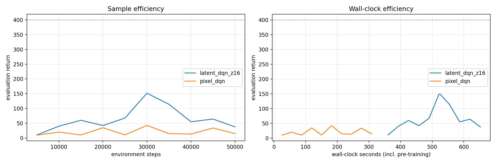
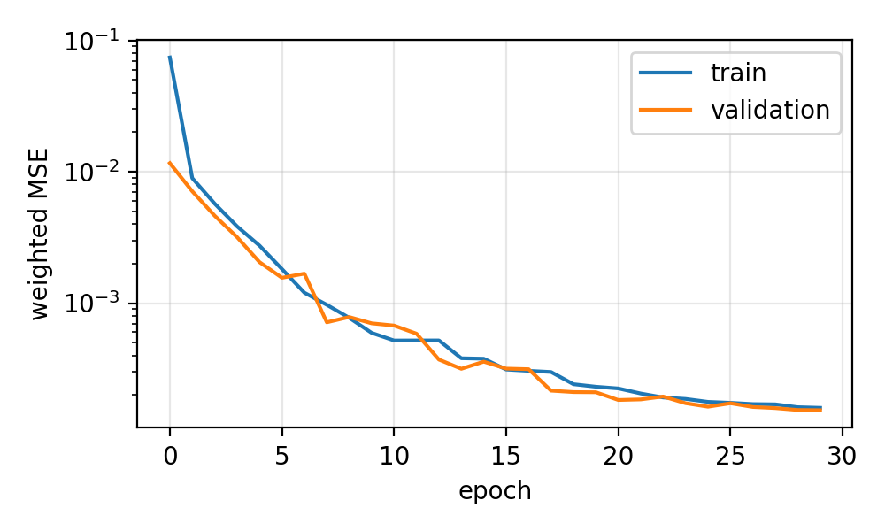
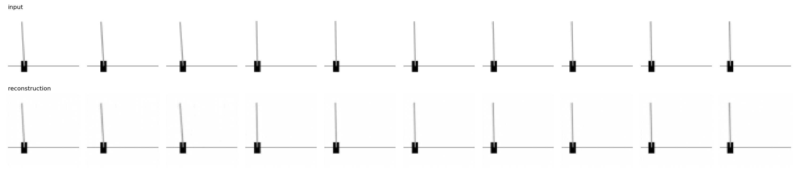
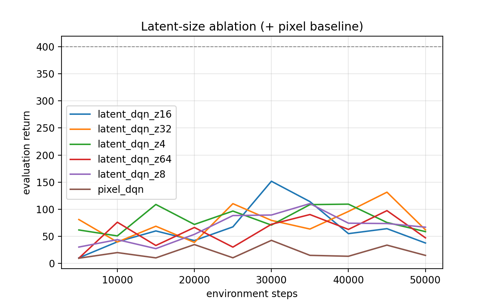

# Unsupervised State
[](https://unsup-latent-visual-rl.streamlit.app)

## 🔗 Interactive Live Demo
Play with the full interactive app live on Streamlit Community Cloud: **[Open Permanent Streamlit Demo](https://unsup-latent-visual-rl.streamlit.app)**


[](https://unsup-latent-visual-rl.streamlit.app)

## 🔗 Live Application
Deploy and run this project interactively: **[Open Permanent Streamlit App](https://unsup-latent-visual-rl.streamlit.app)**

 Representation Learning for Sample-Efficient Visual Reinforcement Learning

[](LICENSE)
[](https://www.python.org/)
[](https://pytorch.org/)
[](https://huggingface.co/spaces/Mulata12/UnSup-Latent-Visual-RL)

A modular, reproducible PyTorch implementation of a **decoupled visual RL pipeline**: a convolutional autoencoder learns a compact latent state from *unlabelled* frames, and a DQN agent learns to act on that latent state. It is compared with an end-to-end pixel DQN baseline on a Gymnasium control task observed only through rendered pixels.

**Author:** Mulata Niguse · **Course / module:** AI Engineering Project · **Date:** 10/25/2025
**Stack:** PyTorch · Gymnasium · Stable-Baselines3 · Gradio · Google Colab (GPU)

---

## 🔴 Live demo

[](https://huggingface.co/spaces/Mulata12/UnSup-Latent-Visual-RL)

**▶ [Open the interactive demo](https://huggingface.co/spaces/Mulata12/UnSup-Latent-Visual-RL)**: hosted on Hugging Face Spaces, no installation needed. Ctrl/Cmd-click (or middle-click) to open it in a new browser tab. A sleeping free Space may need about a minute to wake up.

| Tab | What you can do |
|---|---|
| 1. Latent lens | Move the cart and tilt the pole; see the input, the reconstruction, the error and the latent vector `z` |
| 2. Latent sweep | Heatmap of how every latent dimension responds as the pole angle or cart position changes |
| 3. Bottleneck size | The same scene reconstructed through z = 4, 8, 16, 32 and 64 |
| 4. Live episode | Animated episode through the training pipeline, with the latent vector over time (random policy, or a trained agent if provided) |
| 5. Experiment results | Filterable learning curves, summary / ablation / probe tables and figures |

Run it locally instead with `pip install -r requirements-demo.txt && python demo.py` (see [§6](#6-interactive-demo)).

---

## Table of contents
1. [Overview and research question](#1-overview-and-research-question)
2. [Core architecture](#2-core-architecture)
3. [Method details](#3-method-details)
4. [Experimental protocol and metrics](#4-experimental-protocol-and-metrics)
5. [Results](#5-results)
6. [Interactive demo](#6-interactive-demo)
7. [Repository layout](#7-repository-layout)
8. [Getting started](#8-getting-started)
9. [Reproducibility](#9-reproducibility)
10. [Configuration reference](#10-configuration-reference)
11. [Limitations](#11-limitations)
12. [Future work](#12-future-work)
13. [License and citation](#14-license-and-citation)

---

## 1. Overview and research question

End-to-end visual reinforcement learning must learn *what is in the image* (perception) and *what to do about it* (control) at the same time, from a sparse reward signal. Pixel inputs also require large networks and large replay buffers, which makes training slow and memory-hungry.

This project **decouples the two problems**:

1. **Stage 1 – perception (unsupervised, no rewards):** a convolutional autoencoder (CAE) is trained on unlabelled frames to compress each 64×64 image into a latent vector `z`.
2. **Stage 2 – control (RL):** a DQN agent is trained on stacked latent vectors, and compared with a baseline DQN that learns from raw stacked pixels.

> **Research question.** Does learning a low-dimensional state representation from unlabelled observations, and then doing RL in that latent space, improve **sample efficiency**, **convergence time** and **cumulative reward** compared with learning directly from pixels?

All experiments use PyTorch, Gymnasium (`CartPole-v1`, pixel observations only) and Stable-Baselines3, with cloud GPU resources (Google Colab).

## 2. Core architecture

```
                STAGE 1 (unsupervised frame reconstruction)
 ┌─────────────────┐      ┌───────────────┐      ┌───────────────┐
 │  Pixel render   │ ───▶ │ Convolutional │ ───▶ │ Latent vector │
 │ (64x64x1 gray)  │      │  autoencoder  │      │   z (16-d)    │
 └─────────────────┘      └───────────────┘      └───────────────┘
                                  │                      │
                                  ▼                      ▼
                         Reconstruction loss      Standardisation
                                                  (frozen encoder)

                STAGE 2 (control from the latent state)
 ┌─────────────────┐      ┌───────────────┐      ┌───────────────┐
 │ 4-step latent   │ ───▶ │ DQN: MLP      │ ───▶ │ Action values │
 │ stack z_{t-3:t} │      │ 2 x 256       │      │   Q(s, a)     │
 └─────────────────┘      └───────────────┘      └───────────────┘

                BASELINE
 4 stacked 64x64 frames ───▶ DQN with its own CNN (perception + control learned jointly) ───▶ Q(s, a)
```

### Loss function
Given a pixel observation $x \in \mathbb{R}^{64\times 64\times 1}$, the encoder $E_\phi$ and decoder $D_\theta$ give

$$z = E_\phi(x) \in \mathbb{R}^{d}, \qquad \hat{x} = D_\theta(z).$$

About 97 % of every frame is white background, so plain MSE can be minimised while ignoring the thin pole. We therefore use a **foreground-weighted MSE**:

$$\mathcal{L}(\phi,\theta) = \frac{1}{N}\sum_{p} w_p\,(\hat{x}_p - x_p)^2, \qquad w_p = 1 + \lambda\,\mathbf{1}[x_p \lt 0.95],$$

with $\lambda = 10$ (the `foreground_weight` hyper-parameter).

## 3. Method details

| Component | Details |
|---|---|
| Environment | `CartPole-v1`; the 4-number state is hidden and the agent only sees the rendered image (crop rows 150–350 → grayscale → 64×64 `uint8`) |
| Stage-1 data | 30,000 frames from a random policy, started from a **widened initial-state distribution** so the encoder sees diverse images. No labels, no rewards |
| Autoencoder | Encoder: 4 strided convolutions (64→4) + BatchNorm + ReLU + linear bottleneck. Decoder: mirrored transposed convolutions + sigmoid. Adam, cosine LR decay, 30 epochs, 10 % validation split |
| Latent state | `z ∈ ℝ¹⁶`, standardised with training-set mean / std; **encoder frozen** during RL |
| Why stacking? | One frame carries no velocity. Both pipelines receive the last **4** observations (stacked latents vs stacked frames) |
| RL algorithm | DQN (Stable-Baselines3): `MlpPolicy` (2×256) for latents, `CnnPolicy` for pixels, each with standard hyper-parameters for its input type |

## 4. Experimental protocol and metrics

- **Identical** environment-step budget, evaluation protocol and DQN family for both pipelines.
- **Reported run:** **50,000 environment steps per run, seed 0 only**: a reduced budget (the defaults in `configs/default.yaml` are 100,000 steps and 3 seeds) chosen to save compute time.
- **Evaluation:** greedy policy on a separate environment, 10 episodes every 5,000 steps.
- **Fair timing:** the latent pipeline's wall-clock **includes** data collection and autoencoder training (329 s for z = 16).

| Metric | Definition |
|---|---|
| `final_reward` | mean of the last 3 evaluations (asymptotic performance) |
| `best_reward` | best single evaluation |
| `auc_reward` | normalised area under the learning curve (sample efficiency across the whole run) |
| `steps_to_threshold` | first evaluated step with reward ≥ 400 (NaN if never reached) |
| `pipeline_time_total_s` | total time including autoencoder pre-training |

With more than one seed the code also reports mean ± std and Welch's t-tests; with a single seed these are not defined.

## 5. Results

> **Scope.** One seed and 50,000 steps per run. Every comparison below is **descriptive, not statistical**. No standard deviations or significance tests can be computed from a single run.

### 5.1 Pixel baseline vs latent agent (z = 16)

| Method | Final reward | Best reward | AUC reward | RL time (s) | Total pipeline time (s) | Reached threshold (400) |
|---|:---:|:---:|:---:|:---:|:---:|:---:|
| Pixel DQN (baseline) | 20.4 | 42.4 | 21.1 | 308.5 | **308.5** | 0 / 1 |
| Latent DQN (z = 16) | **52.1** | **151.6** | **68.6** | 323.2 | 652.2 (incl. 329 s pre-training) | 0 / 1 |



*Left: evaluation return vs environment steps. Right: evaluation return vs wall-clock time (latent curve starts after its pre-training).*

**Observations**

- **Sample efficiency (descriptive).** In this run the latent agent reached higher evaluation reward than the pixel agent (AUC 68.6 vs 21.1; best 151.6 vs 42.4). The pixel agent's evaluation reward (about 10–42) stayed close to what a random policy scores on CartPole (roughly 20–25), so it had **not learned a useful policy within 50k steps** under these settings.
- **Neither agent solved the task.** Neither reached the 400 threshold, so steps-to-threshold is undefined for both. *Exploratory, chosen after seeing the results:* the latent agent first exceeded a reward of 100 at 30,000 steps; the pixel agent never did.
- **Instability.** The latent agent's reward peaked at 151.6 (step 30k) and fell to 37.5 by step 50k, so its final score understates its peak and the curve is noisy.
- **Wall-clock.** The pixel pipeline was faster overall (308 s vs 652 s). RL time per 1,000 steps was almost identical (6.2 s vs 6.5 s), which suggests step time is dominated by environment rendering, shared by both pipelines (not profiled). The latent agent's smaller network therefore did not make training faster, and its 329 s pre-training cost is not recovered within this budget.
- **Single-seed caveat.** The z = 16 reward moved between 37 and 152 within a few evaluations; differences of this size between two single runs cannot be attributed to the method rather than to seed noise.

### 5.2 Learned representation




The autoencoder converged smoothly with no sign of over-fitting (weighted loss at z = 16: 0.00016 train / 0.00015 validation). Final validation loss by latent size (from the training logs, one training run per size):

| Latent size | 4 | 8 | 16 | 32 | 64 |
|---|:---:|:---:|:---:|:---:|:---:|
| Validation loss | 0.00043 | 0.00019 | 0.00015 | 0.00039 | 0.00017 |

The loss is not monotonic in latent size (z = 32 is worse than z = 8), which is plausible training variance with one run per size.

**Linear probe.** R² of a ridge regression from a **single-frame** `z` (z = 16) to the true physical state, on held-out frames:

| Physical quantity | R² | Interpretation |
|---|:---:|---|
| Cart position | **0.868** | strongly (linearly) encoded |
| Cart velocity | 0.041 | not recoverable from one frame (expected) |
| Pole angle | 0.011 | **only weakly linearly decodable** |
| Pole angular velocity | 0.003 | not recoverable from one frame (expected) |

- Velocities are not visible in a single image, which is why both pipelines **stack 4 observations**.
- The **pole angle**, the most control-relevant variable, is only weakly linearly decodable. Two plausible but *untested* reasons: the angle may be encoded non-linearly, and the pole's tilt moves only a few pixels once the 600×200 crop is resized to 64×64, so the reconstruction loss gives little incentive to represent it precisely. This is a likely contributor to the latent agent's instability and the main identified weakness of the representation. The demo's *Latent sweep* tab lets you inspect it visually.

### 5.3 Latent-size ablation (one run per size, 50,000 steps)

| Latent size | Final reward | AUC reward | Total pipeline time (s) |
|---|:---:|:---:|:---:|
| 4 | 81.1 | 83.5 | 639.5 |
| 8 | 71.4 | 67.6 | 630.7 |
| 16 (main) | 52.1 | 68.6 | 652.2 |
| 32 | 96.3 | 77.5 | 636.5 |
| 64 | 69.0 | 61.7 | 639.5 |



There is **no monotonic trend**: the smallest (4) and a larger size (32) score highest, and the main setting (16) scores lowest on final reward. With one seed per size and the within-run variability described above, **these differences must not be read as an effect of bottleneck size**. Total time is nearly constant because rendering and pre-training dominate.

### 5.4 Conclusions

1. The pipeline works end to end: the autoencoder trains stably, and its latent representation supports a DQN agent that, in this run, learned faster than a pixel baseline that did not learn within the budget.
2. The evidence is **limited and suggestive, not conclusive**: one seed, 50k steps, neither agent solving the task, and a high-variance latent agent.
3. In this setting the latent approach **did not save wall-clock time**.
4. The weak encoding of the pole angle is the main identified weakness of the learned representation.

### 5.5 Threats to validity
Single seed (no confidence intervals or tests) · short training budget, standard but untuned DQN settings (the pixel baseline may be under-trained) · 10 evaluation episodes per point · different hyper-parameters per input type · one environment and one algorithm.

All values come from `results/tables/` and `results/RESULTS.md`; raw learning curves are in `results/raw/`.

## 6. Interactive demo

The UI (`demo.py`, built with Gradio) runs on CPU and reads the trained encoders from `demo_assets/` and the results from `results/`.

```bash
pip install -r requirements-demo.txt
python demo.py                  # local:  http://127.0.0.1:7860
python demo.py --share          # Colab / remote: prints a temporary public link
```

*(Optional)* add a trained agent to the **Live episode** tab (about 5–6 minutes; a new run with the experiment's settings, so expect a weak agent like the one in §5):
```bash
python scripts/train_demo_agent.py --latent-dim 16 --steps 50000 --seed 0
```

**Re-deploying the hosted demo (Hugging Face Space)**
```bash
pip install huggingface_hub
export HF_TOKEN=hf_xxx           # token with write permission
python scripts/deploy_to_hf_space.py --space Mulata12/UnSup-Latent-Visual-RL \
                                     --github-url https://github.com/mulata12/UnSup-Latent-Visual-RL/
```
The Space rebuilds in a few minutes and serves the demo at https://huggingface.co/spaces/Mulata12/UnSup-Latent-Visual-RL.

## 7. Repository layout

```
latent-visual-rl/
├── README.md · LICENSE · CITATION.cff
├── requirements.txt · requirements-dev.txt · requirements-demo.txt · pyproject.toml · Makefile
├── demo.py                         # Gradio demo entry point
├── demo_assets/                    # trained encoders (cae_z*.pt) and optional demo agent
├── configs/                        # YAML experiment settings (default, smoke_test, ablation)
├── src/latent_visual_rl/
│   ├── config.py · reproducibility.py · cli.py
│   ├── environments/               # pixel / latent observation wrappers, vec-env factory
│   ├── data/                       # unlabelled frame collection
│   ├── representation/             # autoencoder, training loop, checkpoints
│   ├── agents/                     # DQN construction + timed evaluation callback
│   ├── pipelines/                  # cached, resumable pipeline stages
│   ├── analysis/                   # metrics, statistics, plots, diagnostics
│   └── demo/                       # UI logic (rendering, figures, episodes, Gradio app)
├── notebooks/
│   ├── visual_rl_complete_walkthrough.ipynb   # self-contained, commented implementation (produced the results)
│   └── colab_runner.ipynb                     # thin Colab front-end for the package
├── scripts/                        # run_full_experiment.sh, prepare_github_release.sh,
│                                   # train_demo_agent.py, deploy_to_hf_space.py
├── tests/                          # pytest unit tests + end-to-end smoke test
├── results/                        # RESULTS.md, run_info.json, tables/, figures/, raw/ learning curves
└── .github/workflows/ci.yml        # runs the unit tests on every push
```

The notebook and the package implement the same pipeline; the reported results were produced with the walkthrough notebook.

## 8. Getting started

### Option A: Google Colab (recommended)
1. Open `notebooks/latent_visual_RL.ipynb` in Colab and select a **GPU** runtime.

### Option B: local / command line
```bash
git clone https://github.com/mulata12/UnSup-Latent-Visual-RL.git && cd latent-visual-rl
pip install -r requirements.txt && pip install -e .
make test        # fast unit tests
make smoke       # tiny end-to-end run
make all         # full experiment (GPU recommended)
```

| Command | Purpose |
|---|---|
| `python -m latent_visual_rl train-autoencoder` | collect frames and train the autoencoder (cached) |
| `python -m latent_visual_rl train-agents` | train DQN for every method × seed (resumable) |
| `python -m latent_visual_rl ablation --dims 8 32` | latent-size sweep |
| `python -m latent_visual_rl analyze` | tables, t-tests and figures |
| `python -m latent_visual_rl run-all` | agents and analysis |

Any setting can be overridden, e.g. `--set autoencoder.latent_dim=32 --set experiment.seeds=[0,1,2,3,4]`.

## 9. Reproducibility

- All randomness is seeded (`seeds`, `data_seed`); cuDNN is set to deterministic mode.
- The exact configuration and library versions are saved with every run (`results/run_info.json`).
- Datasets, checkpoints and per-run CSVs are cached; every stage is idempotent and resumable.
- No external dataset is needed: frames are generated by the Gymnasium simulator.
- PyTorch does not guarantee bit-identical results across different GPU models, so expect statistically equivalent rather than identical curves.

## 10. Configuration reference

| Group | Parameter | Value used in the reported run |
|---|---|---|
| Observation | image size / crop rows / frame stack | 64×64 / [150, 350] / 4 |
| Autoencoder | latent dim / frames / epochs / batch / LR | 16 / 30,000 / 30 / 256 / 1e-3 (Adam, cosine decay) |
| Autoencoder | foreground weight / validation split | 10 / 10 % |
| RL budget | steps per run / eval interval / eval episodes | 50,000 / 5,000 / 10 |
| DQN pixel | LR / batch / buffer / learning starts | 1e-4 / 64 / 20,000 / 2,000 |
| DQN pixel | train freq / target update / ε-fraction / final ε | 4 / 500 / 0.2 / 0.05 |
| DQN latent | LR / batch / buffer / learning starts | 2.3e-3 / 64 / 100,000 / 1,000 |
| DQN latent | train freq / grad steps / target update | 256 / 128 / 10 |
| DQN latent | ε-fraction / final ε / network | 0.16 / 0.04 / MLP 2×256 |
| Seeds | | 0 |

## 11. Limitations

- **Statistical power:** one seed and a 50k-step budget; no error bars or significance tests.
- **Task and algorithm:** a single simple environment (CartPole) and a single RL algorithm (DQN); conclusions may not transfer to richer visual domains.
- **Representation:** the pole angle is only weakly linearly decodable from `z`; the autoencoder is trained on random-policy data, which covers a narrower state distribution than a trained policy visits (mitigated by widened initial states); reconstruction is not a task-aware objective.
- **Hyper-parameters:** the two agents use different standard settings because their inputs differ; neither was tuned extensively, and the pixel baseline may be under-trained at 50k steps.
- **Timing:** rendering dominates step time, which limits the wall-clock benefit of a smaller policy network.

## 12. Future work

- **More seeds and a longer budget** (the first priority) to obtain error bars and Welch t-tests, which the code already supports.
- **Make the pole visible:** aspect-preserving or higher-resolution inputs, or a non-linear probe to test whether the angle is encoded non-linearly.
- Alternative encoders (VAE / β-VAE, contrastive or inverse-dynamics objectives) and fine-tuning the encoder with an auxiliary RL loss.
- Iterative data collection with the current policy and periodic encoder retraining.
- Other RL algorithms (PPO) and harder environments (Acrobot, CarRacing, Atari).


## 13. License and citation

Released under the MIT License (see `LICENSE`). If you use this work, please cite it using `CITATION.cff`.
